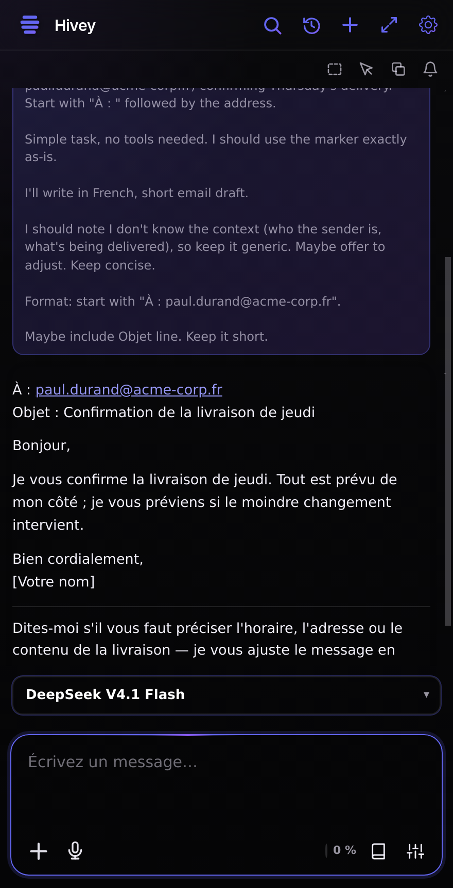
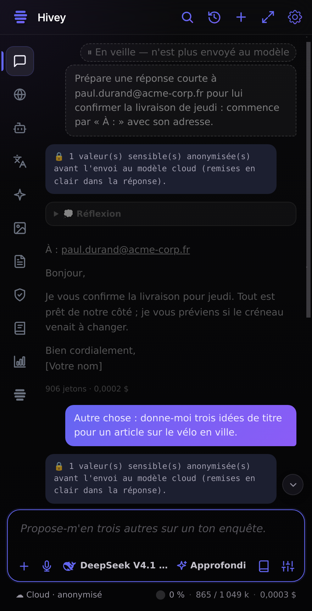
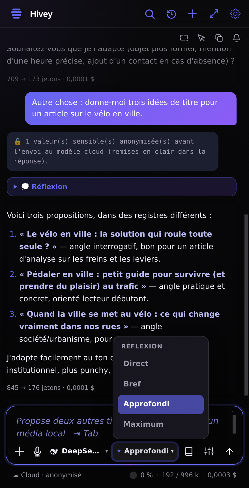
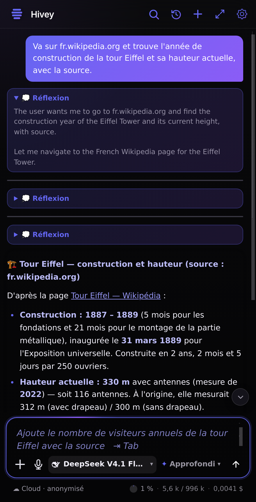
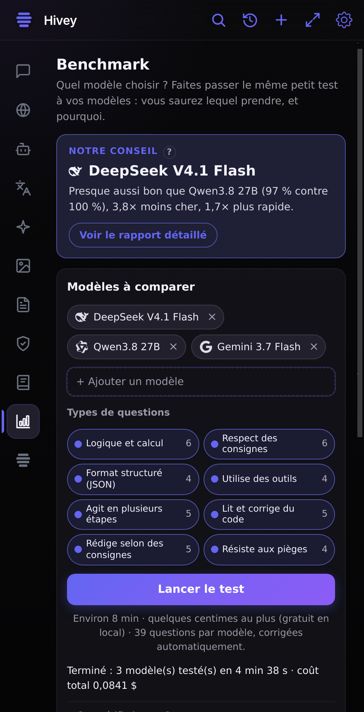
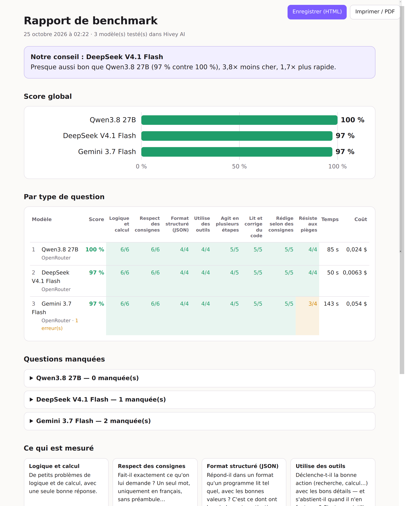
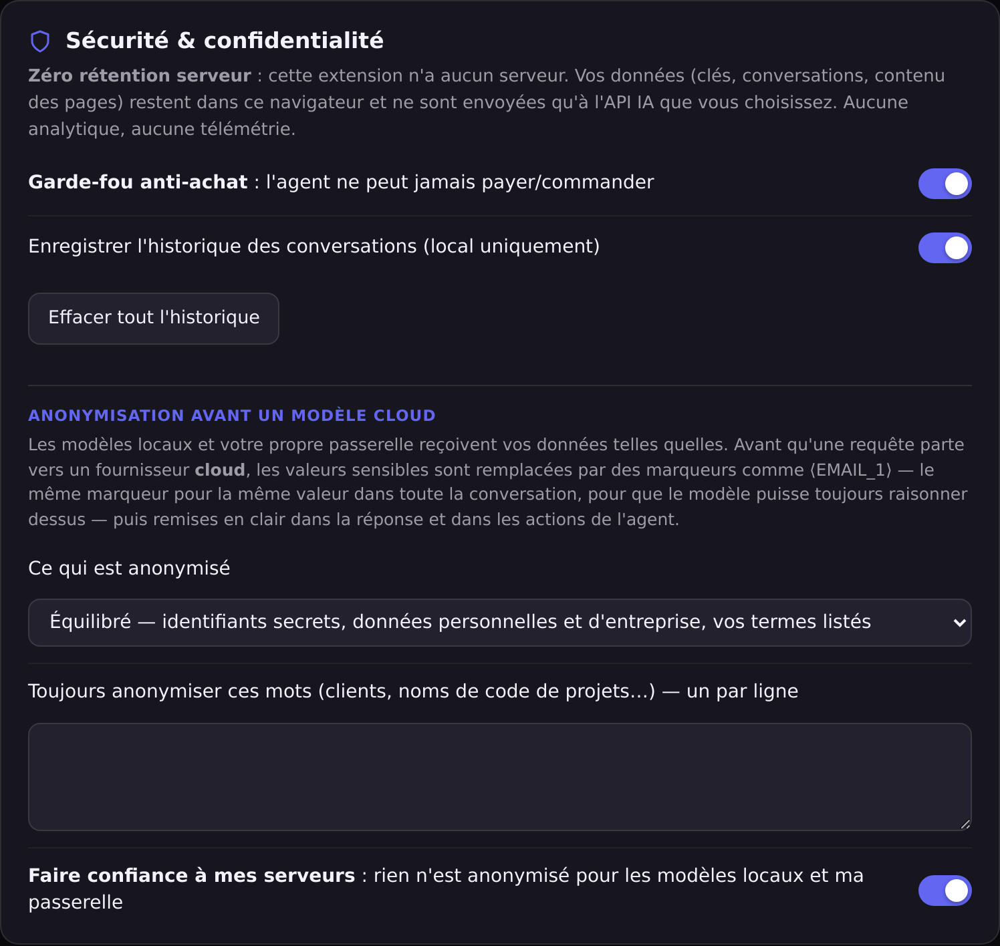
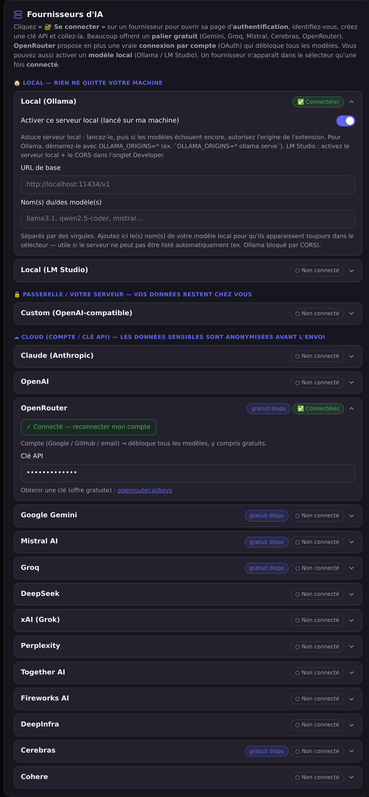

# Hivey AI — IA multi-fournisseurs pour Firefox & Chromium

   [](https://github.com/FlorianMartins/HiveyAI-Sidebar/actions/workflows/ci.yml)

Une extension **open-source** qui ajoute une **sidebar IA** à la manière de
[sider.ai](https://sider.ai), mais où **vous branchez votre propre IA** (BYOK) et
qui **interagit réellement avec la page et les onglets** — ce que la sidebar native
de Firefox ne permet pas. Un équivalent libre n'existait pas.

**Aucun backend, aucune télémétrie, aucune clé fournie.** Tout (clés, conversations,
base de connaissance, embeddings) reste dans votre navigateur.

**Confidentialité d'abord** : vous choisissez où tourne le modèle — 🏠 **local** (rien ne sort),
🔒 **votre passerelle** (vos données restent chez vous) ou ☁️ **cloud** (les données sensibles sont
anonymisées avant l'envoi, puis remises en clair dans la réponse).

📖 **Nouveau venu ?** Le [guide d'utilisation](docs/GUIDE.md) part de zéro : installer, choisir son
modèle, réflexion, agent, contexte, confidentialité.

## 11 espaces de travail

Une **barre latérale d'activité** à gauche (convention « activity bar » façon
VS Code / Slack — scale mieux qu'une rangée d'onglets) donne accès à :

| Espace | Rôle |
|---|---|
| 💬 **Chat** | Conversation avec la page comme contexte + DeepSearch, résumé |
| 🌐 **Web chats** | Gemini, Claude, ChatGPT, Copilot, Mistral, DeepSeek, Qwen, Kimi, Z.ai, HuggingFace **dans la sidebar, sans clé API** (votre session web) |
| 🤖 **Agent** | L'IA lit, navigue, clique, remplit — autorisations réglables + garde-fou anti-achat |
| 🌍 **Traduire** | Traduction page / sélection |
| ✨ **Améliorer** | Réécriture avec styles (Marketing, Newsletter, Email pro, LinkedIn, Tweet, Blog…) |
| 🎨 **Image** | Génération d'images (endpoint compatible OpenAI) |
| 📄 **PDF** | Lecture d'un document et questions dessus |
| 🛡 **Sécurité** | Assistant **cybersécurité défensive** — analyse de capture `.pcap` résumée localement |
| 🧠 **Wisebase** | **Base de connaissance locale + RAG**, embeddings calculés dans le navigateur |
| 📊 **Benchmark** | **Testez vos modèles** (tout fournisseur connecté, local et passerelle compris) sur jusqu'à 39 questions notées automatiquement (logique, consignes, JSON, outils, plusieurs étapes, code, rédaction, pièges — au choix), avec un **rapport** qui s'ouvre tout seul ; classements **publiés** à côté, avec leur fraîcheur réelle |
| `</>` **Code** | Atelier d'app IA complet (aperçu live, terminal, QR Expo Go) |

## Fonctionnalités

- 🔒 **Confidentialité d'abord — local, passerelle ou cloud** : les fournisseurs sont rangés du plus
  privé au moins privé. Avant toute requête vers un modèle **cloud**, identifiants secrets, e-mails,
  téléphones, IBAN, cartes, numéros d'entreprise, noms de sociétés et vos propres termes deviennent
  des marqueurs (`⟨EMAIL_1⟩`…), constants dans la conversation, **remis en clair** dans la réponse,
  la réflexion et les actions de l'agent. Une **fenêtre des données sensibles** montre où se trouve
  chaque donnée (fichier et ligne, page) avant l'envoi : *Envoyer* / *Toujours envoyer (cette
  conversation)* / *Annuler*. Votre machine et votre passerelle reçoivent vos données telles quelles.
- 🧠 **Les vrais niveaux de réflexion de chaque modèle** : Direct, Bref, Standard, Approfondi,
  Extrême, Maximum — seulement ceux que le modèle choisi possède, chacun envoyé comme son fournisseur
  le documente (table reprise de [Hivey Code](https://github.com/FlorianMartins/hivey-vscode)).
- 📏 **Aucune limite manuelle** : ni plafond de longueur de réponse, ni nombre d'étapes de l'agent, ni
  coupe fixe des pages lues — c'est la fenêtre réelle du modèle qui décide. La conversation est
  résumée d'elle-même à 75 % de cette fenêtre, et un serveur qui la refuse la voit résumée puis la
  question reposée.
- 🎛 **Un contexte maîtrisé, dans tous les onglets** : mettre un échange **en veille** (affiché mais
  plus envoyé), l'**épingler** (gardé mot pour mot dans les résumés), le **supprimer** ; une **jauge
  de contexte** cliquable pour résumer et libérer la fenêtre.
- 🐝 **Moteur Hivey — orchestration multi-modèles** : au lieu de choisir un modèle,
  choisissez une **intention**. Trois variantes (**🎁 Free**, **⚡ Smart**, **✨ Pro**)
  routent chaque message vers le meilleur modèle pour la tâche — un dispatcher LLM
  bon marché classe la demande (code / raisonnement / recherche / maths / créatif /
  test / trivial) et bascule sur le palier adéquat, avec repli heuristique si le
  dispatcher échoue. Le catalogue est **auto-curé quotidiennement**, sans version en dur.
- 🧠 **Wisebase (RAG 100% local)** : importez documents et pages dans des collections ;
  le texte est découpé, **vectorisé dans le navigateur** (transformers.js +
  onnxruntime WASM, modèle `all-MiniLM-L6-v2`) et stocké en **IndexedDB**. Les
  réponses citent vos sources. Rien n'est jamais téléversé ; désinstaller l'extension
  purge la base.
- 🔎 **DeepSearch** : bascule de recherche web approfondie dans le chat, avec une
  **profondeur réglable** (rapide / standard / approfondie).
- 📚 **Prompt Library** : prompts prêts à l'emploi (rédaction, code, cybersec,
  marketing, productivité, apprentissage, business, data) + vos propres prompts,
  favoris et insertion en un clic.
- ⚡ **Skills & slash-commands** : `/skill` applique un prompt d'expert qui reste actif
  (chip) et rend **n'importe quel modèle** meilleur sur un domaine — pur prompt
  engineering côté client, donc compatible avec tous les fournisseurs.
- 📊 **Modèles classés par spécialité** : chaque espace trie sa liste de modèles selon
  un **index de qualité curé par catégorie** (les endpoints `/models` n'exposent aucun
  score) — le picker de l'onglet Image ne classe pas comme celui de l'onglet Code.
- ⌨️ **Raccourcis clavier configurables** (nouveau chat, focus composer, historique…) : on
  clique, on appuie sur la combinaison ; conflits et combinaisons réservées au navigateur signalés.
- 🎛️ **Réglages clairs** : une colonne de cartes qui suit votre thème, de 360 px à l'écran large,
  et un **Accès rapide** d'interrupteurs (anonymisation, recherche web, suggestion, artefacts,
  vérification, compaction, mémoire, son, thème clair…) enregistrés aussitôt.
- 🔐 **Sauvegarde/synchro chiffrée** : export d'un blob **AES-256-GCM** (PBKDF2, 100k
  itérations) de vos réglages et clés, à transporter vers un autre appareil.
  Rien ne transite par un serveur — la synchro, c'est vous qui déplacez le fichier.
- 📤 **Export de conversation** (impression / PDF via le rendu natif du navigateur).
- 🎨 **Interface moderne & personnalisable** : **6 thèmes** (Dark, Hive, Modern, Neon,
  Sunset, Light) avec **personnalisation des couleurs par-dessus** (accent, fond,
  surface, texte) et une **pipette** pour capturer une couleur à l'écran. Zone de
  saisie unifiée façon Claude/Gemini, et **sélecteur de modèle unifié** au-dessus
  du chat (une seule liste groupée par fournisseur connecté).
- 🔌 **Tous les fournisseurs** : **Claude**, **OpenAI**, **Gemini**, **Mistral**,
  **Groq**, **DeepSeek**, **xAI (Grok)**, **Perplexity**, **Together**, **Fireworks**,
  **DeepInfra**, **Cerebras**, **Cohere**, **OpenRouter**, et les **modèles locaux**
  **Ollama** / **LM Studio** (ou tout serveur compatible OpenAI via URL personnalisée).
- 📋 **Seulement les modèles disponibles** : la liste (unifiée, juste au-dessus du
  chat) n'affiche que les fournisseurs **connectés** (clé/compte/serveur local) et,
  pour chacun, les **modèles réellement accessibles** à votre clé (lus en direct via
  l'endpoint `/models`).
- 🔑 **Connexion par compte** : bouton **« Se connecter avec OpenRouter »** (OAuth
  PKCE — login Google / GitHub / email côté OpenRouter) qui débloque tous les
  modèles. Les autres fournisseurs utilisent une clé API (ils n'offrent pas d'OAuth).
- ⚖️ **Comparaison de modèles** : sur **la dernière réponse**, un bouton
  **« Comparer »** rejoue votre demande sur **un autre modèle**, directement dans le chat.
- 🧩 **Artifacts interactifs (façon Claude)** : demandez une app, un outil ou un
  **jeu** → l'IA renvoie un document HTML/JS (ou un composant **React/JSX**) qui
  s'exécute dans un aperçu sandboxé **et avec lequel vous interagissez/jouez**
  directement. (Mermaid/SVG pour les diagrammes.)
- 🕘 **Historique local** : vos conversations sont enregistrées **uniquement dans
  ce navigateur** (privacy) ; liste, rechargement, et « tout effacer ».
- 🌐 **Web chats sans clé API** : dix IA grand public (Gemini, Claude, ChatGPT,
  Copilot, Mistral, DeepSeek, Qwen, Kimi, Z.ai, HuggingFace) s'ouvrent **dans la
  sidebar**, via votre session web déjà connectée — utile quand vous n'avez pas de
  clé ou que votre abonnement est déjà payé.
- 🛡 **Espace Sécurité défensive** : assistant orienté défense, avec un parseur
  `.pcap` **côté client** qui ne produit qu'un **résumé anonymisé** (flux, top
  talkers/ports, mix protocolaire, heuristiques de scan TCP) — **jamais** les
  charges utiles. Seul ce résumé peut partir vers le modèle.
- 🌍 **Interface multilingue** : anglais, français, espagnol, allemand, italien,
  portugais (réglable dans les paramètres) — les six sont **complètes**, et un test
  échoue si une clé manque dans l'une d'elles.
- 👁 **L'IA voit la page** : le contenu est lu automatiquement à l'ouverture d'un
  site **et à chaque navigation** (y compris changement de sous-domaine et
  navigations SPA), puis utilisé comme support pour répondre.
- 📑 **Lecture multi-onglets** : cochez plusieurs onglets ouverts pour les donner
  comme contexte à l'IA (comparer, synthétiser, recouper).
- ⚡ **Actions rapides** + **clic droit** : Résumer / Traduire la **page** ou la
  **sélection**, Expliquer, Améliorer, **Rédiger une réponse**.
- 🔍 **Recherche dans la conversation**, **glisser-déposer** de fichiers, et un
  **outil de capture de zone** (📸) qui ajoute une capture d'écran de la page au contexte.
- 💭 **Réflexion** : le raisonnement du modèle (thinking adaptatif de Claude, `reasoning` d'OpenRouter,
  `reasoning_content` de DeepSeek et des serveurs llama.cpp) s'affiche dans un bloc repliable, et
  **revient au modèle à l'étape suivante** — il reprend son raisonnement au lieu de tout recommencer.
- 🤖 **Espace Agent** (onglet dédié) : l'IA peut lire la page/les onglets, naviguer,
  cliquer, remplir des champs. **Sans limite d'étapes** : il s'arrête quand la tâche est finie, sur
  ■, ou quand il tourne en rond (la même lecture sans que rien n'ait changé — il écrit alors où il
  en est). Un message tapé pendant qu'il travaille **corrige sa trajectoire** à l'étape suivante.
  **Autorisations réglables** : *Autoriser* (par défaut —
  exécution automatique, mais les **actions sensibles** comme télécharger, réserver,
  supprimer, s'inscrire demandent quand même confirmation) ou *validation manuelle*
  (confirmation avant chaque action). Un **liseré lumineux** s'affiche sur la page
  pendant que l'agent travaille.
  Dans les deux cas, le **garde-fou anti-achat** s'applique : elle peut remplir un
  panier mais **ne peut jamais payer/commander**. Un **modèle d'agent** dédié est
  réglable (beaucoup de modèles rapides/gratuits ne savent pas appeler d'outils).
- 🛠 **Espace Code — atelier d'app IA** : ouvre, dans un **nouvel onglet isolé**, un
  builder d'apps web & mobiles — **HiveyCode** (`https://app.hivey.be` par défaut) — avec
  **génération de code par une boucle d'agents** (planner → coder → reviewer → debugger),
  **aperçu live**, **terminal intégré** et **QR code Expo Go** pour tester sur mobile.
  L'URL de l'atelier est **configurable** dans les réglages (votre instance
  auto-hébergée ou l'instance publique). *Pourquoi un onglet et pas une
  iframe ?* le builder s'appuie sur **WebContainers**, qui exigent l'isolation
  cross-origine (COOP/COEP) impossible dans une iframe d'extension — le nouvel onglet
  préserve preview, terminal et Expo Go.
- 🔒 **100% BYOK, zéro rétention serveur** : aucune clé fournie, **aucun serveur**,
  aucune télémétrie. Vos clés et données restent **locales** (`storage.local`),
  jamais synchronisées, envoyées uniquement à l'API que vous choisissez — anonymisées si c'est un cloud.

## Captures

| Anonymisation avant le cloud | Contexte maîtrisé | Niveaux de réflexion du modèle |
|---|---|---|
|  |  |  |

| L'agent dans le navigateur | L'onglet Benchmark | Le rapport, ouvert à la fin du test |
|---|---|---|
|  |  |  |

| Réglages de confidentialité | Fournisseurs : local d'abord |
|---|---|
|  |  |

Captures faites le 24 octobre 2026 dans Chromium avec l'extension réelle et un vrai modèle cloud
(DeepSeek V4.1 Flash via OpenRouter). Artifacts : [aperçu HTML](docs/screenshots/artifact-html-preview.png),
[Markdown et Mermaid](docs/screenshots/sidebar-markdown-mermaid.png).

## Installation

### Version de développement (toujours à jour)

Reconstruite à chaque modification poussée, après les mêmes vérifications que la CI :

- Firefox : [hivey-ai-sidebar-firefox.zip](https://github.com/FlorianMartins/HiveyAI-Sidebar/releases/download/dev/hivey-ai-sidebar-firefox.zip) — `about:debugging#/runtime/this-firefox` → **Charger un module complémentaire temporaire…** → choisir le `.zip`
- Chrome / Edge / Brave : [hivey-ai-sidebar-chrome.zip](https://github.com/FlorianMartins/HiveyAI-Sidebar/releases/download/dev/hivey-ai-sidebar-chrome.zip) — décompresser, puis `chrome://extensions` → **Mode développeur** → **Charger l'extension non empaquetée**

Ce qui change à chaque version : [CHANGELOG.md](CHANGELOG.md).

### Firefox (développement)

1. Ouvrir `about:debugging#/runtime/this-firefox`
2. **Charger un module complémentaire temporaire…**
3. Sélectionner `manifest.json` à la racine de ce dépôt
4. La sidebar s'ouvre via l'icône de la barre latérale ou `Ctrl+Shift+Y`
5. Cliquer ⚙ **Réglages** et renseigner **au moins une clé API** (ou pointer un
   modèle local Ollama / LM Studio, sans clé)

### Chromium (Chrome / Edge / Brave…)

L'extension est **cross-browser** : le même code tourne sur Chromium grâce à
[`browser-polyfill`](https://github.com/mozilla/webextension-polyfill) et à un
manifest dédié (`side_panel` + service worker au lieu de `sidebar_action`).

1. Construire le paquet : `bash scripts/build-chrome.sh` → `ai-sidebar-chrome-<version>.zip`
   (ou décompresser le zip fourni)
2. Ouvrir `chrome://extensions`, activer le **Mode développeur**
3. **« Charger l'extension non empaquetée »** → sélectionner le dossier `.build-chrome/`
   (ou le contenu décompressé du zip)
4. Cliquer l'icône de la barre d'outils pour ouvrir le **panneau latéral**

> Note : Chrome ne permet pas la distribution d'un `.crx` permanent hors
> **Chrome Web Store** (compte développeur payant). Le chargement « non empaqueté »
> ci-dessus est la voie sans store ; il nécessite de garder le Mode développeur actif.

## Fournisseurs

Trois catégories, présentées dans cet ordre dans les réglages :
🏠 **local** (rien ne quitte la machine), 🔒 **passerelle / serveur personnel** (votre serveur
compatible OpenAI — une URL hors du réseau local est traitée comme une passerelle), ☁️ **cloud**
(anonymisation avant l'envoi). La fenêtre de contexte de chaque modèle vient du catalogue OpenRouter
(régénéré chaque jour) ou, pour votre serveur, de son propre `/v1/models`.

| Fournisseur | Type | Clé requise | Notes |
|---|---|---|---|
| Claude (Anthropic) | natif | ✅ | thinking + recherche web ; liste `/v1/models` |
| OpenAI | compatible OpenAI | ✅ | images (gpt-image-1 / DALL·E 3) |
| Google Gemini | compatible OpenAI | ✅ | endpoint `/v1beta/openai` |
| Mistral, Groq, DeepSeek | compatible OpenAI | ✅ | DeepSeek R1 = raisonnement |
| xAI (Grok), Perplexity | compatible OpenAI | ✅ | Grok / Sonar |
| Together, Fireworks, DeepInfra, Cerebras, Cohere | compatible OpenAI | ✅ | open-weights + listing `/models` |
| OpenRouter | compatible OpenAI | ✅ (ou OAuth) | catalogue géant, **connexion par compte** |
| Local (Ollama) | compatible OpenAI | ❌ | `http://localhost:11434/v1` |
| Local (LM Studio) | compatible OpenAI | ❌ | `http://localhost:1234/v1` |
| Passerelle / serveur personnel | compatible OpenAI | optionnel | n'importe quelle URL `/v1` (llama.cpp, llama-swap, vLLM…) ; budget de réflexion par niveau sur llama.cpp |

> Les serveurs locaux fonctionnent sans configuration CORS : l'extension dispose
> des *host permissions* et n'est donc pas soumise au CORS du navigateur.

## Architecture

```
manifest.json            MV3 Firefox (sidebar_action, event page)
manifest.chrome.json     MV3 Chromium (side_panel, service worker)
scripts/build-chrome.sh  Assemble le paquet Chromium (.zip / dossier)
src/
  background/sw-chrome.js  Entrée service worker Chromium (importScripts)
  background/            Event page : menus contextuels (résumer/traduire/…)
  sidebar/               UI principale (chat, streaming, thinking, actions rapides)
  content/               Lecture page + actions DOM + notif. de navigation SPA
  options/               Réglages : accès rapide, cartes par section, clés BYOK par fournisseur
  lib/
    models.js            Catalogue des fournisseurs + modèles + presets d'écriture
    providers.js         Client Anthropic natif + client générique OpenAI ; images ; aucun plafond fixe,
                         champ refusé retiré puis renvoyé, connexion coupée reprise, cache de prompt
    reasoning.js         Niveaux de réflexion par fournisseur et par modèle (table de Hivey Code)
    model-catalog.generated.js  GÉNÉRÉ : fenêtres de contexte + profils de réflexion (OpenRouter)
    conversation.js      Un tour de chat : budget = fenêtre réelle, résumé à 75 %, reprise sur débordement
    context-control.js   Veille / épingle / suppression par échange (clés `_` jamais envoyées)
    agent-guards.js      Freins de l'agent : boucles, réflexion qui tourne, fenêtre, correction en route
    privacy.js           Local / passerelle / cloud ; anonymisation et fenêtre des données sensibles
    redaction/           Détecteurs, coffre de marqueurs, restitution en flux (repris de Hivey Code)
    user-language.js     Langue de l'utilisateur (7 langues), nommée au modèle
    harness.js           Noyau de raisonnement : coutures, journal de session, événements
    agent.js             Tour d'agent monté sur le noyau (prompt système + greffons)
    tools.js             Outils navigateur (onglets, DOM) + exécuteur
    auth.js              Connexion OAuth (PKCE) OpenRouter via browser.identity
    history.js           Historique local des conversations (storage.local)
    storage.js           Réglages locaux (clés/modèles/URLs, autorisations agent, URL atelier Code)
    markdown.js          Rendu Markdown + artifacts interactifs (HTML/JS, React, SVG, Mermaid)
    hivey-models.js      Moteur Hivey : paliers par capacité, auto-curation du catalogue
    benchmarks.js        Index de qualité curé par famille de modèle et par catégorie
    benchmark-web.js     GÉNÉRÉ : résultats publiés (Aider, Vectara) + fraîcheur de chaque source
    benchmarkView.js     Espace Benchmark : modèles à tester, résultats par famille, classements publiés
    bench-report.js      Rapport de benchmark (HTML autonome, sans script) ouvert à la fin d'un test
    livebench.js         Épreuves notées par programme (raisonnement, consigne, JSON, outils)
    wisebase.js          Base de connaissance locale + RAG (collections, chunks, IndexedDB)
    embeddings.js        Embeddings calculés dans le navigateur (transformers.js / WASM)
    skills.js            Skills experts + objectifs, exposés en slash-commands
    prompts.js           Prompt Library intégrée (8 catégories, bilingue)
    pcap.js              Parseur .pcap client → résumé défensif anonymisé
    shortcuts.js         Raccourcis clavier configurables (lecture des touches, conflits, réservés)
    quick-toggles.js     Interrupteurs de l'accès rapide des réglages
    syncCrypto.js        Export/import chiffré AES-256-GCM des réglages (PBKDF2)
    exportConversation.js Export/impression d'une conversation
    theme.js             6 thèmes + surcouche de couleurs personnalisées
    i18n.js / i18n-langs.js  Traductions UI (en, fr, es, de, it, pt)
    dom.js               Point d'insertion HTML unique (audit sécurité)
tests/                   Suite node:test — `npm test`, aucune dépendance
bench/                   Banc chat + agent : tâches vérifiées par des faits, web simulé
scripts/bench.mjs        Lance le banc sur une ou deux versions (`--root`) côte à côte
scripts/bench-hivey.mjs  Banc de qualité Hivey (routage + code exécuté) ; `--candidates=` = comparatif
scripts/auto-tier.mjs    Réaffectation des rôles au meilleur modèle MESURÉ (timer hebdomadaire)
scripts/update-benchmarks.mjs  Collecte des classements publiés (timer quotidien)
```

### Détails techniques

- **Noyau de raisonnement** (`lib/harness.js`) : la boucle d'agent ne garde que la
  mécanique — tours, étapes, appels d'outils. Tout ce qui décide *de ce qui a le
  droit d'arriver* s'enregistre depuis l'extérieur. Le journal de session fait
  foi : la requête envoyée au modèle est **dérivée** de ce journal à chaque étape,
  jamais tenue à côté, si bien que la transcription ne peut pas diverger de ce qui
  a réellement été envoyé. Avant chaque appel, `agent/pre-step` laisse un
  auditeur réécrire la requête ou la **refuser**, ce qui clôt le tour sans avoir
  rien dépensé. Inspiré de DeepSeek Harness (et du paradigme Cordis), implémenté
  ici de zéro : aucune dépendance, aucun appel à DeepSeek.

- **MV3 / Firefox** : `sidebar_action` (équivalent Chrome : `side_panel`).
  Le background est un *event page* (`background.scripts`).
- **Un seul client pour presque tout** : la majorité des fournisseurs parlent le
  dialecte OpenAI (`/chat/completions`, `/models`, `/images/generations`). Un
  client générique paramétré par `baseUrl` + `apiKey` les couvre tous ; seul
  Anthropic a son client natif (extended thinking, recherche web serveur).
- **Anthropic depuis le navigateur** : header
  `anthropic-dangerous-direct-browser-access: true` + `x-api-key` +
  `anthropic-version: 2023-06-01`.
- **Les « yeux »** : la sidebar écoute `tabs.onActivated` / `tabs.onUpdated` et les
  notifications SPA du content script ; à chaque navigation elle relit la page,
  l'affiche dans un chip et l'injecte (mode chat) ou la laisse à l'agent (mode agent).
- **Réflexion** : blocs `thinking` d'Anthropic (avec signature conservée pour rester
  valide au tour suivant), `reasoning_details` d'OpenRouter et `reasoning_content`
  (DeepSeek, llama.cpp) renvoyés au modèle à l'étape suivante ; les niveaux passent par
  `reasoning.js` (adaptive + `output_config.effort` sur les Claude récents, `reasoning.effort`
  sur OpenRouter, `reasoning_effort` ailleurs, budget de réflexion sur llama.cpp).
- **Aucune limite manuelle** : pas de `max_tokens` fixe (celui qu'exige Anthropic est appris de
  son refus), pas de plafond d'étapes, sorties d'outils dimensionnées à la fenêtre du modèle ;
  quand un tour d'agent approche de la fenêtre, les plus anciens résultats sont raccourcis puis le
  travail est résumé en direct (`context/compacted` dans le journal de session).

## Sécurité & confidentialité

- **Anonymisation avant le cloud** (`src/lib/privacy.js`, détecteurs de `src/lib/redaction/`) :
  toutes les requêtes vers un fournisseur cloud — de tous les onglets, tâches annexes comprises —
  passent par un coffre de marqueurs réversible et constant sur la conversation. Les marqueurs écrits
  par le modèle sont remis en clair dans la réponse (même coupés entre deux paquets du flux), la
  réflexion et les **arguments des outils de l'agent**. Une tâche annexe qui devrait demander une
  confirmation n'est pas envoyée. Le modèle n'est informé des marqueurs que lorsqu'il y en a.
- **Zéro rétention serveur** : l'extension n'a **aucun backend**. Aucune donnée
  (clés, conversations, contenu des pages) ne transite par un serveur tiers — tout
  reste dans le navigateur et n'est envoyé qu'à l'API IA que **vous** choisissez.
  Pas d'analytique, pas de télémétrie.
- Les clés API sont stockées via `browser.storage.local` (jamais synchronisées).
  **Aucune clé n'est fournie** : le dépôt est livré vierge.
- **Garde-fou anti-transaction** : en mode agent, les actions de
  paiement/commande/saisie de carte sont **refusées dans le code** (content script),
  pas seulement dans le prompt — un prompt détourné ne peut pas les contourner.
  L'agent s'arrête au panier.
- **Anti prompt-injection — séparation structurelle, pas une consigne** : le contenu
  des pages, onglets, PDF et sélections n'est **plus concaténé** au message de
  l'utilisateur. Chaque source devient un **message distinct**, encadré par une
  clôture portant un **nonce aléatoire de 128 bits régénéré à chaque tour**
  (`src/lib/untrusted.js`). Le canal d'instruction ne contient donc que deux choses :
  le prompt système et le texte tapé par l'utilisateur. Une page ne peut pas fermer
  un bloc dont elle ne peut pas deviner le délimiteur.
  > Cette section affirmait auparavant que le prompt système constituait la défense.
  > Ce n'en était pas une : aucune formulation ne résiste à une injection indirecte
  > bien construite, puisque la formulation et l'attaque arrivent par le même canal.
  > Le dépôt appliquait déjà le bon principe pour l'anti-achat — du code, pas un
  > prompt — et cette séparation l'étend au reste.
- **Onglets authentifiés** : l'agent **refuse dans le code** toute action visant les
  dix sites de chat IA que l'espace Web chats intègre (sessions connectées). Le refus
  a lieu **avant l'appel au modèle**, donc sans dépense.
- **Modèle de menaces** : vecteurs, impacts, mitigations codées et **résiduels
  assumés** sont détaillés dans [docs/THREAT-MODEL.md](docs/THREAT-MODEL.md).
- **Autorisations de l'agent réglables** : en *Autoriser* (par défaut) l'agent
  s'exécute seul mais **confirme les actions très sensibles** (téléchargement, le
  bouton qui réserve, suppression, virement, inscription, installation…) — chercher et
  comparer sur un site de réservation reste libre ; en *validation
  manuelle* chaque action modifiant l'état est confirmée ; en *tout autoriser* l'agent enchaîne
  sans demande — mais le **garde-fou anti-achat reste actif dans les deux cas**
  (refus codé en dur, indépendant du prompt). Le défaut sûr est la validation manuelle.
- **Espace Code isolé** : l'atelier d'app IA s'ouvre dans un **onglet distinct**
  (origine séparée, protégé côté serveur). Aucune clé, aucun réglage et aucune donnée
  de la sidebar n'est partagé avec l'atelier ; l'URL cible est explicitement
  configurée par l'utilisateur (pas de redirection silencieuse). La séparation
  d'origine (WebContainers/COOP-COEP) qui empêche l'embarquement en iframe **renforce**
  aussi l'isolation : la sidebar et l'atelier ne partagent pas de contexte d'exécution.
- **Wisebase entièrement local** : les collections, les extraits de texte **et les
  vecteurs d'embedding** vivent en IndexedDB. Les embeddings sont calculés **dans le
  navigateur** (moteur WASM embarqué dans l'extension) ; seul le *modèle* (~23 Mo) est
  téléchargé une fois depuis le CDN Hugging Face puis mis en cache. Aucun texte ne sort.
- **Analyse `.pcap` anonymisante** : le parseur tourne côté client et ne produit qu'un
  **résumé statistique** (flux, ports, protocoles). Les charges utiles ne sont ni
  extraites ni envoyées.
- **Sauvegarde chiffrée, pas de cloud** : l'export des réglages est chiffré en
  **AES-256-GCM** avec une clé dérivée par **PBKDF2 (100 000 itérations)**. Le fichier
  est déplacé par vos soins — il n'existe aucun serveur de synchro.
- **Point d'insertion HTML unique** : toute écriture de HTML passe par `src/lib/dom.js`,
  ce qui réduit la surface XSS à un seul fichier auditable. Le Markdown du modèle est
  systématiquement passé dans **DOMPurify** avant rendu.
- **`declarativeNetRequest` au périmètre minimal** : les règles ne s'appliquent qu'aux
  **11 domaines de chat web** effectivement supportés — aucun domaine
  d'authentification, aucun domaine parent large.
- **CSP stricte** sur les pages d'extension (`script-src 'self'`) ; les artifacts
  (HTML/JS/React/SVG/Mermaid) s'exécutent en **iframe sandboxée** (origine opaque,
  sans `allow-same-origin`), isolés de l'extension, des pages et des clés.
- **Historique 100% local** : les conversations sont stockées dans
  `storage.local` (jamais synchronisées) ; désactivable et effaçable dans les réglages.
- **Note artifacts React** : un artifact `jsx`/`react` charge React + Babel depuis
  un CDN public (`unpkg`) **à l'intérieur de l'iframe sandboxée uniquement**, et
  seulement quand un tel artifact est affiché. Les artifacts **HTML/JS** (jeux, apps)
  ne dépendent d'aucun CDN. La connexion OpenRouter passe par `browser.identity`.
- `anthropic-dangerous-direct-browser-access` expose la clé Anthropic au contexte
  navigateur de l'utilisateur (BYOK assumé) — acceptable car chacun fournit la sienne.

## Rendu Markdown & artifacts

Réponses rendues en **Markdown** (marked + DOMPurify, vendorés dans `vendor/`).
Blocs de code avec barre d'outils (**Copier**), et des **artifacts interactifs**
(façon Claude) dans des **iframes sandboxées**, avec bascule **Aperçu / Code** et
bouton **Ouvrir** (plein écran) :

- ` ```html ` → **app / jeu / outil** autonome, exécuté et **jouable** dans l'aperçu
- ` ```jsx ` (ou `react`) → **composant React** (définir `App`), transpilé en direct
- ` ```svg ` → graphique vectoriel rendu
- ` ```mermaid ` → diagramme rendu automatiquement

## Mémoire (opt-in, désactivée par défaut)

Une mémoire **à étages**, consultée à la demande, conçue pour ne pas augmenter votre facture.
Ce n'est pas de la compression de jetons : c'est un **déplacement de la dépense**.

| | |
|---|---|
| tour ordinaire | **0 jeton** — aucune recherche, aucun modèle appelé, rien d'injecté |
| consultation | ~30 jetons pour demander + ~200 jetons de synthèse sur votre modèle |
| les ~3 000 jetons de candidats | lus par un modèle **local ou gratuit**, jamais par le vôtre |

- **Trois étages** : un profil borné (~800 jetons, gelé pendant la session pour préserver le cache
  du fournisseur), des schémas consolidés, et les épisodes bruts (gzip + vecteurs int8 — **99,4 %
  de rappel mesuré**, 12,7 Mo pour 20 000 épisodes).
- **Provenance obligatoire** : seuls `user` et `agent` sont stockables. Rien qui vienne d'une page,
  d'un onglet ou d'un PDF n'est jamais écrit. Chaque espace de travail a une capacité déclarée
  (`memory-policy.js`) ; le mode agent ne lit que ce que **vous** avez dit.
- **Une mémoire n'est jamais une instruction** : elle est injectée après le préfixe stable, dans une
  clôture dédiée, avec la mention explicite que ce que vous dites maintenant l'emporte.
- **Vous voyez ce qui part** : ligne de statut nommant la **destination** et le nombre, panneau
  dépliable montrant le texte transmis *tel quel*, sa provenance, sa date et son coût en jetons —
  avec « pas cette fois » distinct de « supprimer définitivement ».
- **Choix du modèle mémoire** dans les Réglages : serveur local, tier gratuit, ou n'importe quel
  modèle de votre clé avec son **prix affiché**. Sans configuration : gratuit. Jamais un modèle
  cher choisi à votre place.
- **Banc d'admission** (`npm run memory:admission`) : 30 cas mesurant le rappel, la **fabrication**
  (des distracteurs absents des sources) et la latence. Un modèle n'entre dans le pool que s'il
  passe le seuil.

Menaces, mitigations codées et **résiduels assumés** : [docs/THREAT-MODEL.md](docs/THREAT-MODEL.md).

## Tests

```sh
npm test              # suite complète (node:test, zéro dépendance)
npm run check:numbers # les chiffres de la doc (version, nombre de tests) sont-ils vrais ?
npm run models:check  # le catalogue de modèles est-il à jour ?
npm run vendor:check  # les bibliothèques tierces sont-elles les originaux amont ?
npm run bench -- --url http://127.0.0.1:8080/v1 --model qwen-27b   # le banc chat + agent
```

**457 tests** (node:test) couvrent le noyau de raisonnement et le tour d'agent de bout en bout, les
niveaux de réflexion de chaque fournisseur (le corps exact de chaque requête), l'anonymisation
(détecteurs, faux positifs, restitution, fenêtre des données sensibles), la gestion du contexte, les
freins de l'agent, le routage Hivey, et **la complétude des six langues**. Les tests des niveaux de
réflexion et de l'anonymisation sont ceux de [Hivey Code](https://github.com/FlorianMartins/hivey-vscode),
transposés.

**CI** (chaque PR et chaque envoi sur `main`) : tests sur Node 20, 22 et 24 (Linux et Windows),
contrôle des chiffres de la doc, empreinte des bibliothèques tierces, `web-ext lint` de Mozilla sur
le paquet exact, paquets Firefox et Chromium avec attestation de provenance, CodeQL, gitleaks,
actionlint + zizmor. `main` est protégée par ces contrôles.

### Le banc chat + agent

`bench/` contient 27 tâches sur les onglets Chat, Agent, Sécurité et Wisebase, décidées par des
**faits** — un chiffre, une langue, du code exécuté, ce que l'agent a envoyé, visité ou payé —
jamais par un modèle juge. L'agent y agit avec ses vrais outils sur un **web simulé**
(`bench/browser.mjs`, mêmes formats que `content.js`), pour mesurer le modèle et l'extension, pas
l'état d'internet ce jour-là. `scripts/bench.mjs --root DIR` charge le code d'une version donnée :
deux versions tournent côte à côte sur le même serveur. **Règle** : une modification du chat ou de
l'agent n'est fusionnée que si elle fait au moins aussi bien que la version précédente.

Le banc `scripts/bench-hivey.mjs` mesure la qualité réelle des variantes Hivey :
précision du routeur sur un jeu de prompts étiquetés (FR + EN), et exactitude du
rôle code, en **exécutant** le code produit contre des assertions.

## Feuille de route

- [x] Multi-fournisseurs + modèles locaux (Ollama / LM Studio / custom)
- [x] Moteur **Hivey** : orchestration multi-modèles (Free / Smart / Pro) + auto-curation du catalogue
- [x] **Wisebase** : base de connaissance locale + RAG, embeddings dans le navigateur
- [x] **DeepSearch**, **Prompt Library**, **Skills** en slash-commands
- [x] **Web chats sans clé API** (10 IA grand public dans la sidebar)
- [x] **Espace Sécurité défensive** + parseur `.pcap` anonymisant côté client
- [x] Lecture auto de la page à chaque navigation (sous-domaine, SPA) + multi-onglets
- [x] Espace agent avec autorisations réglables + garde-fou anti-achat
- [x] Espace Code : atelier d'app IA en nouvel onglet (preview, terminal, Expo Go)
- [x] Artifacts interactifs façon Claude (HTML/JS jouable, React/JSX)
- [x] Historique local, export de conversation, sauvegarde chiffrée, raccourcis configurables
- [x] 6 thèmes + couleurs personnalisées, interface en 6 langues
- [x] **Conformité magasins** : `addons-linter` **0 erreur / 0 note**, manifests Firefox
      et Chromium dédiés, périmètre `declarativeNetRequest` restreint, déclaration de
      collecte de données
- [ ] Soumission **AMO** (canal *listed*)
- [ ] Soumission **Chrome Web Store**
- [x] **Confidentialité d'abord** : local / passerelle / cloud, anonymisation et fenêtre des données sensibles
- [x] **Niveaux de réflexion propres à chaque modèle**, sans limite manuelle de longueur ni d'étapes
- [x] **Contexte maîtrisé** : veille, épingle, suppression par échange, jauge et résumé à la demande
- [x] **CI/CD** au niveau de Hivey Code + **banc chat + agent** comme condition de fusion

## Licence

MIT — voir [LICENSE](./LICENSE).

## Building

The extension ships hand-written, non-minified source (only `vendor/` holds unmodified third-party libraries). To reproduce the exact packages: `bash scripts/build.sh`. Verify the third-party libs with `bash scripts/fetch-vendor.sh --check`.
