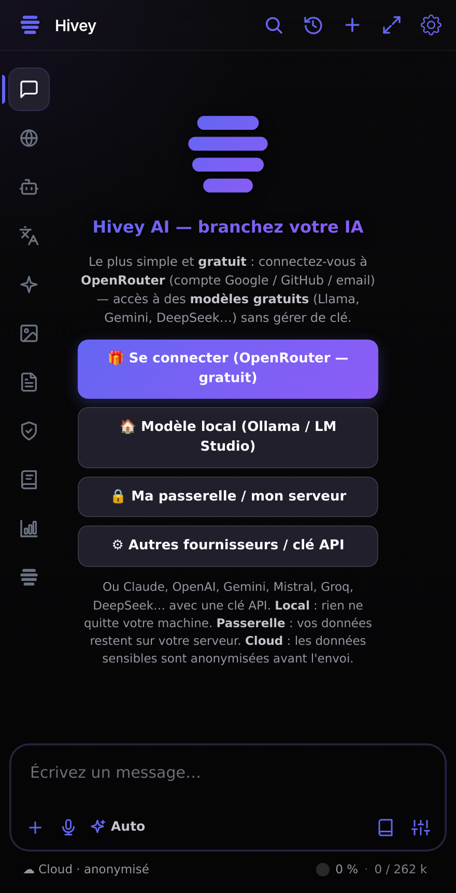
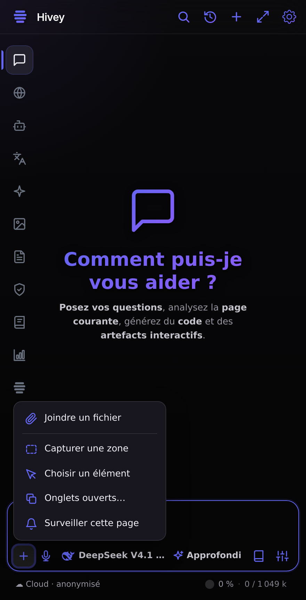
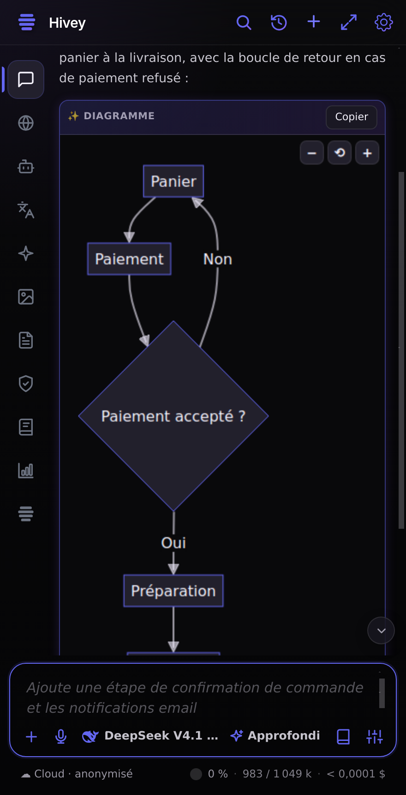
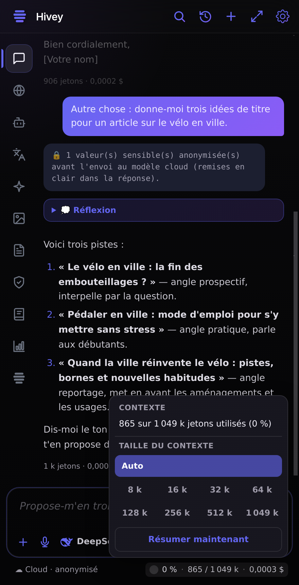
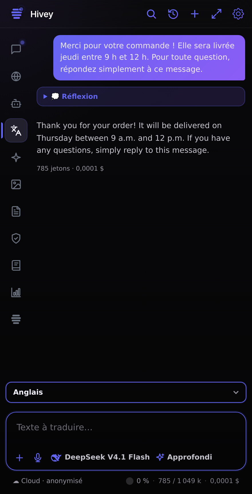
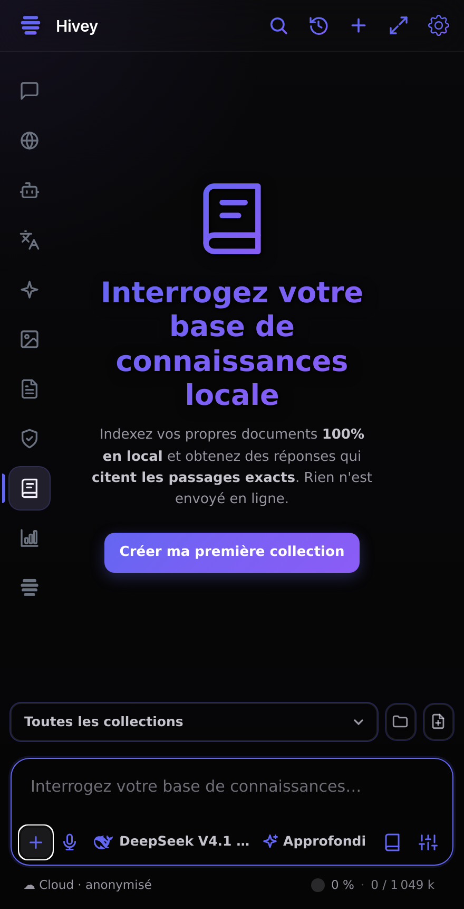
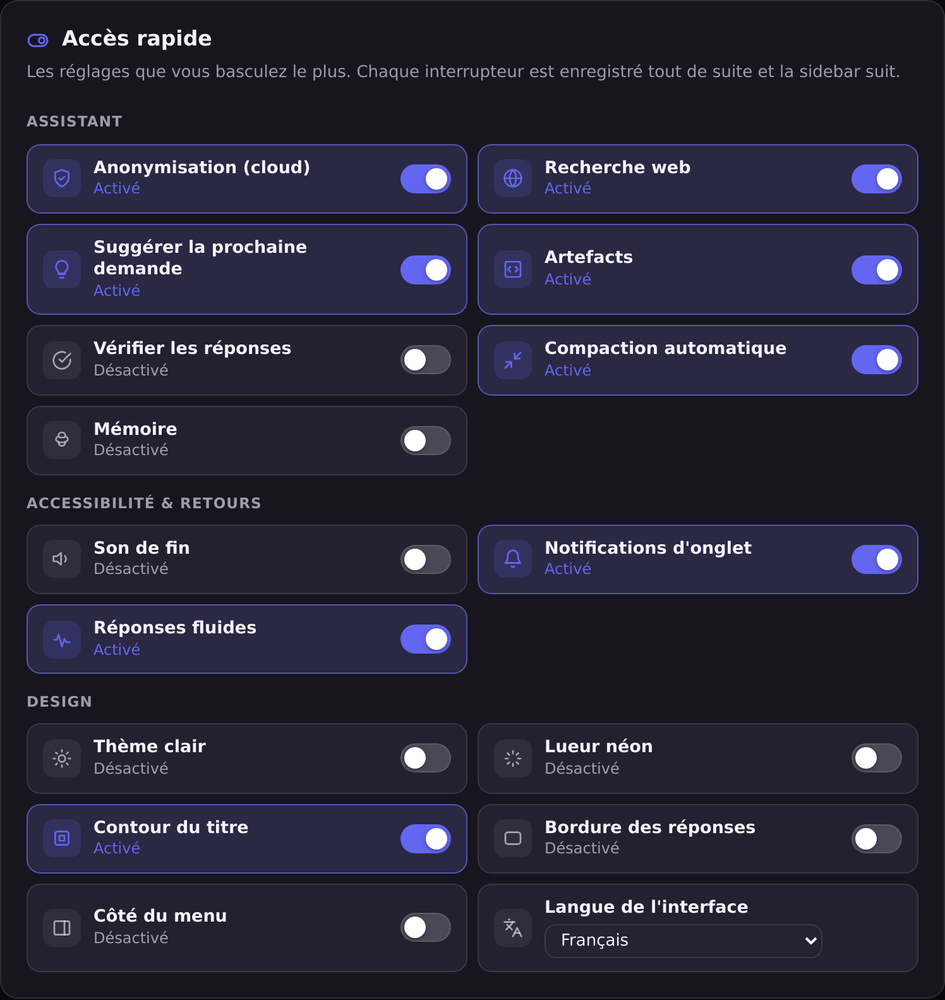

# Guide d'utilisation de Hivey AI

Ce guide part de zéro : installer la sidebar, choisir où tourne votre modèle, puis tirer le
meilleur de chaque onglet sans perdre en confidentialité. Chaque section est indépendante.

- [1. Installer et premier lancement](#1-installer-et-premier-lancement)
- [2. Choisir son modèle : local, passerelle ou cloud](#2-choisir-son-modèle--local-passerelle-ou-cloud)
- [3. La zone de saisie, la même dans tous les onglets](#3-la-zone-de-saisie-la-même-dans-tous-les-onglets)
- [4. Le Chat : questions, page en contexte, recherche web, artefacts](#4-le-chat--questions-page-en-contexte-recherche-web-artefacts)
- [5. Les niveaux de réflexion](#5-les-niveaux-de-réflexion)
- [6. L'Agent : il agit dans le navigateur](#6-lagent--il-agit-dans-le-navigateur)
- [7. Garder un contexte propre](#7-garder-un-contexte-propre)
- [8. Confidentialité : ce qui part, et sous quelle forme](#8-confidentialité--ce-qui-part-et-sous-quelle-forme)
- [9. Les autres onglets](#9-les-autres-onglets)
- [10. Les réglages](#10-les-réglages)
- [11. Questions fréquentes](#11-questions-fréquentes)

---

## 1. Installer et premier lancement

**Étape 1 — installer la version de développement** (toujours à jour, reconstruite à chaque
modification après les vérifications de la CI) :

| Navigateur | Lien | Installation |
|---|---|---|
| Firefox | [hivey-ai-sidebar-firefox.zip](https://github.com/FlorianMartins/HiveyAI-Sidebar/releases/download/dev/hivey-ai-sidebar-firefox.zip) | `about:debugging#/runtime/this-firefox` → **Charger un module complémentaire temporaire…** → choisir le `.zip` |
| Chrome / Edge / Brave | [hivey-ai-sidebar-chrome.zip](https://github.com/FlorianMartins/HiveyAI-Sidebar/releases/download/dev/hivey-ai-sidebar-chrome.zip) | décompresser → `chrome://extensions` → **Mode développeur** → **Charger l'extension non empaquetée** |

**Étape 2 — ouvrir la sidebar** : icône de la barre latérale dans Firefox (ou `Ctrl+Shift+Y`),
icône de la barre d'outils dans Chromium (panneau latéral, ou `Ctrl+Shift+Y` aussi).

**Étape 3 — brancher un modèle.** Au premier lancement, quatre boutons :

- **🎁 Se connecter (OpenRouter — gratuit)** : connexion par compte (Google, GitHub, e-mail), sans
  clé à copier ; des modèles gratuits sont disponibles tout de suite ;
- **🏠 Modèle local** : trouve Ollama ou LM Studio sur votre machine et le sélectionne ;
- **🔒 Ma passerelle / mon serveur** : l'URL de votre serveur (et sa clé s'il en demande une),
  vérifiés sur place ; son premier modèle est choisi ;
- **⚙ Autres fournisseurs / clé API** : ouvre les réglages (Claude, OpenAI, Gemini, Mistral…).

**Étape 4 — les onglets.** La **barre des onglets** est à gauche, ouverte par défaut : Chat, Web,
Agent, Traduire, Améliorer, Image, PDF, Sécurité, Wisebase, Benchmark, Code. ☰ (en haut à gauche) la
masque ou la remontre, et ce choix est gardé. En haut à droite : 🔍 chercher dans la conversation,
🕘 historique (local), `+` nouvelle conversation, ⤢ agrandir, ⚙ réglages.

Ce qui change à chaque version est dans le [journal des modifications](../CHANGELOG.md) (aussi
accessible depuis les réglages : « Nouveautés »).

 

## 2. Choisir son modèle : local, passerelle ou cloud

Ouvrez ⚙ **Réglages** → **Fournisseurs d'IA**. Ils sont rangés du plus privé au moins privé, chacun
replié sur une ligne avec son état (« Connecté(e) » ou non) ; un clic l'ouvre.

| | Où tourne le modèle | Ce qui part de votre machine | Pour qui |
|---|---|---|---|
| 🏠 **Local** | Ollama ou LM Studio sur votre ordinateur (ou votre réseau local) | rien | confidentialité maximale, hors ligne |
| 🔒 **Passerelle / votre serveur** | un serveur compatible OpenAI que vous (ou votre entreprise) contrôlez — par exemple `https://ai.votre-domaine/v1` + une clé | vers votre serveur seulement | équipe, modèle partagé, sans fournisseur tiers |
| ☁️ **Cloud** | Claude, OpenAI, Gemini, Mistral, DeepSeek, OpenRouter… avec **votre** clé | vers ce fournisseur, **après anonymisation** des données sensibles | les modèles les plus puissants |

- **Local** : installez [Ollama](https://ollama.com) (`ollama pull qwen3`) ou LM Studio, activez la
  carte dans les réglages ; la liste des modèles installés apparaît seule.
- **Passerelle** : carte « Custom (OpenAI-compatible) », renseignez l'URL (terminée par `/v1`) et la
  clé si votre serveur en demande une. La fenêtre de contexte réelle du serveur est lue
  automatiquement (llama.cpp, llama-swap, vLLM, LM Studio l'annoncent).
- **Cloud** : collez une clé API, ou utilisez **« Se connecter avec OpenRouter »** (connexion par
  compte, sans clé à copier).

**Les modèles Hivey** (via OpenRouter, logo Hivey dans la liste) choisissent pour vous le bon modèle
à chaque message :

| Préréglage | Ce qu'il utilise |
|---|---|
| 🎁 **Hivey Free** | les meilleurs modèles gratuits, avec passage automatique à un autre quand l'un est limité |
| ⚡ **Hivey Smart** | le plus précis pour le moins cher : **Sonnet 5.5** partout, **Opus 5.5** pour les raisonnements et les maths |
| ✨ **Hivey Pro** | le plus puissant : **Fable 5.1** pour les raisonnements et les maths, **Opus 5.5** pour le chat, le code, l'agent et la rédaction, **Sonnet 5.5** pour la vision, la recherche et la vérification |

Le modèle se choisit ensuite **dans la zone de saisie**, par la puce qui porte l'icône du
fournisseur et le nom du modèle (voir §3). Seuls les fournisseurs connectés y apparaissent.

## 3. La zone de saisie, la même dans tous les onglets

Écrivez, puis **Entrée** pour envoyer (`Maj+Entrée` pour aller à la ligne). Il n'y a pas de bouton
Envoyer ; pendant la réponse, **■** l'arrête. Sous le texte, une rangée d'icônes, toutes à la
couleur de votre thème :

| Élément | Rôle |
|---|---|
| `+` | un menu : **joindre un fichier**, ou apporter la page — **capturer une zone**, **choisir un élément**, **onglets ouverts…**, **surveiller cette page** (et, dans Sécurité, **les en-têtes de sécurité de la page**) |
| 🎤 | dicter (voir §11) |
| **puce du modèle** (icône du fournisseur + nom) | changer de modèle : toute la puce ouvre la liste, avec une recherche |
| **puce de réflexion** (✦ + niveau) | le niveau de réflexion du modèle, voir §5 |
| 📖 | la bibliothèque de prompts (Chat et Wisebase) |
| **options** (curseurs) | Vérifier, DeepSearch (avec sa profondeur), Web, Artifacts — selon l'onglet |
| sous le cadre, à gauche | où tourne le modèle : 🏠 Local, 🔒 Votre passerelle, ☁️ Cloud · anonymisé — sur un modèle cloud, **un clic active ou désactive l'anonymisation** (voir §8) |
| sous le cadre, à droite | **la jauge de contexte** (anneau, %, jetons utilisés / taille de la fenêtre) et, pour un modèle cloud, le coût de la conversation ; **un clic** ouvre la taille du contexte et « Résumer maintenant » (voir §7) |

Le cadre prend la couleur du thème au survol et au clic ; **pendant que le modèle répond ou agit**,
une lumière en fait le tour. Taper `/` ouvre les commandes et les skills (un prompt d'expert qui
reste actif), taper `@` propose d'ajouter la page actuelle ou un onglet ouvert au contexte.

Les réglages propres à un onglet sont **au-dessus du cadre**, sur toute la largeur : la langue de
Traduire, le style et le ton d'Améliorer, la collection Wisebase, les analyses de Sécurité. Dans
Image, la **taille** est une puce dans le cadre. Ces listes sont alphabétiques et se parcourent au
clavier : tapez « fr » pour sauter à Français, flèches, Entrée pour choisir, Échap pour fermer.

Quand la sidebar est étroite (Firefox l'ouvre à environ 250 px), le nom « Hivey » s'efface, puis le
modèle et la réflexion ne montrent plus que leur icône (leur nom reste au survol).

 

## 4. Le Chat : questions, page en contexte, recherche web, artefacts

- **La page que vous regardez** n'est pas envoyée d'office. Pour la donner au modèle : tapez `@` →
  « Page actuelle » (ou un onglet), ou activez « L'IA voit la page courante » dans les réglages
  (Comportement). Elle est alors donnée **une fois par conversation**, et relue quand vous naviguez.
  Le contenu d'une page est traité comme une **donnée**, jamais comme une instruction : une page qui
  écrit « ignore tes consignes » n'est pas obéie.
- **Recherche web** (🌐 dans les options, **activée par défaut**) : elle ne part **que si la
  question en a besoin** — un lien, « cherche sur le web », l'actualité, un prix, la météo, des
  horaires → recherche ; écrire, traduire, coder, calculer, reformuler → pas de recherche ; les cas
  douteux sont tranchés par une question oui/non à un modèle économique. Le modèle répond alors avec
  ses sources. **DeepSearch** mène une recherche en plusieurs étapes (rapide, standard ou
  approfondie), avec un rapport cité.
- **Vérifier** (dans les options) relit et corrige la réponse — seulement quand l'option est
  activée (des appels en plus).
- **Pièces jointes** : `+` → Joindre un fichier, ou glissez des fichiers, des images, un PDF, un
  `.zip` ; une case permet de laisser une pièce jointe hors du contexte sans la retirer.
- **La langue** : le modèle répond dans la langue de votre question, même après avoir lu une page
  dans une autre langue.
- **Le coût** : sous chaque réponse, le nombre de jetons et le prix (« 906 jetons · 0,0002 $ ») ; le
  détail envoyés → reçus est au survol. « Gratuit » pour un modèle gratuit, rien en local.
- **Suggestion de la prochaine demande** : après une réponse, une suite proposée apparaît en italique
  pâle dans le champ vide ; **Tab** (ou →) la reprend, il suffit sinon de taper autre chose.
  Désactivable dans les réglages.
- **Comparer** : sur la dernière réponse, rejoue votre demande sur un autre modèle.

**Artefacts et diagrammes.** Avec l'option **Artifacts**, le modèle ne produit une app, un jeu ou
un diagramme **que si vous le demandez** (« construis », « dessine », « visualise »…) :

- un **diagramme** (Mermaid) s'affiche dans la réponse, aux couleurs de votre thème ; zoom avec
  − ⟲ +, `Ctrl` + molette ou pincement, glisser pour se déplacer, double-clic pour revenir à 100 % ;
  « Ouvrir » l'affiche en grand dans un onglet ;
- une **app ou un jeu** (HTML, React) apparaît comme une carte **« Ouvrir dans un onglet »** : un
  clic le lance en plein écran, isolé du reste, où il est jouable ; « Code » montre la source.

 

## 5. Les niveaux de réflexion

La **puce de réflexion** (à côté du modèle) propose **les niveaux que le modèle choisi possède
vraiment**, et seulement ceux-là :

| Niveau | Effet |
|---|---|
| **Direct** | pas de réflexion préalable — le plus rapide (absent si le modèle réfléchit toujours) |
| **Bref** | une réflexion courte |
| **Standard** | l'équilibre |
| **Approfondi** | réfléchit longuement avant de répondre |
| **Extrême**, **Maximum** | les efforts supplémentaires de certains modèles (Claude récents, GPT, Grok…) |

**Chaque modèle démarre sur son niveau recommandé** (celui que son fournisseur déclare par défaut,
sinon Standard), affiché sur la puce. Le niveau que vous choisissez est **retenu pour ce modèle** :
passer à un autre modèle reprend le niveau de celui-ci. Au survol d'un niveau, vous voyez le mot
exact envoyé au modèle.

La réflexion s'affiche dans un bloc « Réflexion » **replié** au-dessus de la réponse (il clignote
pendant que le modèle réfléchit) ; un clic l'ouvre.

 

## 6. L'Agent : il agit dans le navigateur

L'onglet 🤖 **Agent** lit les pages, navigue, clique, remplit des formulaires, compare des onglets.
Écrivez la tâche, Entrée ; un liseré lumineux entoure la page pendant qu'il travaille.

- **Il travaille dans un onglet qui lui est dédié** : vous pouvez continuer à naviguer ailleurs.
- **Il va au bout** : pas de limite au nombre d'étapes. Il s'arrête quand la tâche est finie, quand
  vous appuyez sur ■, ou s'il tourne en rond (la même lecture refaite sans que rien n'ait changé) —
  il vous dit alors où il en est.
- **Corrigez-le en route** : tapez un message pendant qu'il travaille ; il le lit à l'étape
  suivante (« ↪ Transmis à l'agent »), sans devoir l'arrêter.
- **Ce qu'il a fait reste consultable** : « Actions (N) — cliquer pour consulter » liste ses actions
  dans l'ordre (📄 lecture, 🖱️ clic, ⌨️ saisie…) ; un clic sur une action en montre le détail.
- **Réservations et voyages** : il remplit le formulaire de recherche des sites (destination, dates,
  voyageurs), applique vos critères, lit le total du séjour ou du trajet sur la page de l'offre et
  compare les sites dans un tableau. Il s'arrête **avant** le bouton qui réserve.
- **Recherche approfondie** : il part de la source officielle et en suit les pages jusqu'à avoir
  répondu à chaque partie de la question, avec les liens des sources.
- **Il ne paiera jamais** : le garde-fou anti-achat est dans le code ; il s'arrête au panier. Les
  actions très sensibles — télécharger, **le bouton qui réserve** (« Réserver maintenant »,
  « Confirmer la réservation »), supprimer, s'inscrire, installer — vous sont demandées même en mode
  « Autoriser » (le mode par défaut). Chercher, comparer et ouvrir une offre ne le sont pas.
- **Musique et vidéos** : « mets-moi … » lance la vidéo avec le son. Si le navigateur n'autorise le
  son qu'après un clic sur la page (Firefox), la vidéo attend **en pause, son activé** : **un seul
  clic** sur Lecture (ou sur « ▶ Lire avec le son ») la lance avec le son.
- Pour les longues tâches, il résume lui-même son travail quand la fenêtre du modèle se remplit,
  et continue.

 

## 7. Garder un contexte propre

Tout ce qui reste dans la conversation est relu par le modèle à chaque question. Une fausse piste
ou un long journal déjà analysé « tirent » les réponses suivantes. Sous chaque message, des icônes
(leur nom s'affiche au survol) :

| Icône | Effet |
|---|---|
| ⏸ **Veille** | l'échange (votre question + la réponse) reste affiché mais **passe en gris** (question en pointillés), marqué « ⏸ En veille — n'est plus envoyé au modèle », et **n'est plus envoyé**. Un nouveau clic, ou un clic sur l'étiquette, le remet. |
| 📌 **Épingler** | l'échange est gardé **mot pour mot** quand la conversation est résumée |
| 🗑 **Supprimer** | l'échange disparaît de l'écran et du contexte |

L'icône prend la couleur du thème quand elle est active.

 

**La jauge de contexte** (sous la zone de saisie, à droite) montre la part de la fenêtre du modèle
qu'occupe ce qui est réellement envoyé — le compte du fournisseur, consignes et outils compris,
comme sous la réponse. Elle devient orange puis rouge. **Un clic** ouvre :

- **la taille du contexte** pour ce modèle : **Auto** (par défaut — la plus grande fenêtre du
  modèle), ou une taille de 8 k jusqu'au maximum du modèle. Plus petit, c'est moins cher et plus
  rapide : la conversation est résumée plus tôt. Pour les modèles Hivey, la jauge affiche la plus
  petite fenêtre des modèles du préréglage (1 000 k pour Smart, 262 k pour Free) ;
- **Résumer maintenant**, qui libère le contexte (tout reste affiché).

La conversation se résume aussi **d'elle-même à 75 %** de la taille choisie — un message provisoire
« 🗜 Résumé de la conversation… » s'affiche pendant ce temps, puis dit ce qui a été fait — dans le
Chat, l'Agent et Wisebase ; si un serveur répond qu'elle ne tient plus, elle est résumée puis la
question est reposée.

Ces boutons existent dans **Chat, Agent, Sécurité, Traduire, Améliorer, PDF et Wisebase**. Dans
l'onglet **Image**, « ↺ Utiliser comme référence » met une image générée dans le contexte de la
génération suivante.

 

## 8. Confidentialité : ce qui part, et sous quelle forme

- **Local et passerelle** : vos données partent telles quelles, vers votre machine ou votre serveur.
- **Cloud** : avant l'envoi, les valeurs sensibles sont remplacées par des **marqueurs** —
  `⟨EMAIL_1⟩`, `⟨PHONE_1⟩`, `⟨IBAN_1⟩`, `⟨SECRET_1⟩`… — le **même marqueur pour la même valeur**
  dans toute la conversation, pour que le modèle continue de raisonner. Ils sont **remis en clair**
  dans la réponse, dans la réflexion et dans les actions de l'agent : un formulaire est rempli avec
  la vraie adresse. Un avis « 🔒 N valeur(s) sensible(s) anonymisée(s) » le signale. Les petites
  requêtes annexes (titre, résumé, suggestion, question « faut-il chercher sur le web ? ») le sont
  aussi.
- **Les pages web publiques** gardent leurs prix (le modèle doit pouvoir les comparer) ; leurs
  e-mails, téléphones et identifiants sont masqués. Ce que **vous** écrivez, joignez ou analysez est
  entièrement couvert.
- **La fenêtre des données sensibles** : en mode anonymisé, tout part en marqueurs, sans question —
  une seule note « 🔒 N valeurs anonymisées » par valeur et par conversation. **Anonymisation
  désactivée**, avant d'envoyer au cloud un identifiant secret (clé, mot de passe), la sidebar montre
  **où** il se trouve (`config.env:12`, la page, un résultat de l'agent) et vous choisissez :
  **Envoyer (marqueurs en place)**, **Toujours envoyer (cette conversation)** ou **Annuler** — rien
  n'est envoyé.
- **Le badge « ☁️ Cloud · anonymisé »** sous la zone de saisie : un clic **désactive
  l'anonymisation** (il passe en orange, « non anonymisé ») ; un second clic la **réactive** au
  niveau choisi dans les réglages. Même désactivée, les **clés et mots de passe restent masqués**.
  Elle est active par défaut. L'interrupteur « Anonymisation (cloud) » des réglages fait la même
  chose.
- **Réglages** (Sécurité & confidentialité) : niveau **Strict** (ajoute adresses IP, machines
  internes, noms d'utilisateur dans les chemins), **Équilibré** (par défaut) ou **Identifiants
  seulement** ; une liste de **mots à toujours anonymiser** (noms de clients, noms de code) ; et
  « faire confiance à mes serveurs ».

Rien de tout cela ne passe par un serveur de Hivey : il n'y en a pas. Les clés, conversations
et bases Wisebase restent dans votre navigateur. Détails :
[politique de confidentialité](../privacy-policy.html) et [modèle de menaces](THREAT-MODEL.md).

 

## 9. Les autres onglets

- 🌐 **Web** : Claude, ChatGPT, Gemini, Copilot, Mistral, DeepSeek, Qwen, Kimi, Z.ai et HuggingChat
  **dans la sidebar, avec votre propre session** (sans clé API). Choisissez le site dans la liste en
  haut ; Claude y garde son propre menu (conversations passées, projets) et sa page de connexion ;
  🕘 ouvre directement vos conversations Claude. L'icône des outils de page envoie au chat la page,
  un élément, une capture ou des onglets. Si un site refuse de s'afficher dans le panneau, un bandeau
  propose de **l'ouvrir dans un onglet**.
- 🌍 **Traduire** : choisissez la langue au-dessus du cadre (« Choisissez une langue », puis la
  dernière utilisée ; tapez pour y sauter), collez ou écrivez le texte, Entrée. Le clic droit sur
  une page ou une sélection propose aussi « Traduire ».
- ✨ **Améliorer** : choisissez un style (e-mail pro, LinkedIn, newsletter…) et un ton au-dessus du
  cadre — recliquer sur le ton choisi le retire — puis collez votre texte.
- 🎨 **Image** : génération et retouche d'images (fournisseur compatible OpenAI) ; la taille est une
  puce dans le cadre ; une image générée peut servir de référence à la suivante.
- 📄 **PDF** : ouvrez un document et posez des questions dessus ; un résumé en un clic.
- 🛡 **Sécurité** : assistant de cybersécurité **défensive** — choisissez une analyse au-dessus du
  cadre (en-têtes HTTP, journaux, e-mails suspects, captures réseau `.pcap` résumées **dans le
  navigateur**, sans les charges utiles). Il refuse de produire des outils d'attaque et propose
  l'équivalent défensif.

 

- 🧠 **Wisebase** : votre base de connaissance **locale**. Sans collection, un bouton **« Créer ma
  première collection »** attend dans la page ; ensuite, importez documents et pages (📁 gère les
  collections, 📄+ ajoute la page courante). Les textes sont vectorisés **dans le navigateur** ; les
  réponses citent les passages `[1]`, `[2]`… et disent clairement quand la base ne contient pas la
  réponse. Les questions de suivi voient les précédentes.
- 🔌 **MCP** : vos services connectés (Gmail via Zapier, Notion, Jira, Linear…). Le bouton
  **Services** de la zone de saisie ouvre le catalogue et le champ « autre serveur MCP » ; la lecture
  se fait seule, tout envoi ou modification vous est demandé d'abord.
- L'icône Hivey ↗ en bas de la barre ouvre l'atelier **Hivey Code** dans un nouvel onglet.

 

- 📊 **Benchmark** — « quel modèle choisir ? » :
  1. **Ajoutez les modèles à comparer** (le modèle actuel est déjà là ; local, passerelle et cloud) ;
  2. **choisissez les types de questions** (tous cochés par défaut ; la durée et le prix estimés
     suivent) ;
  3. **Lancer le test** : jusqu'à 39 questions corrigées par un programme, environ trois minutes par
     modèle pour le test complet, quelques centimes au plus (gratuit en local). Une ligne dit quel
     modèle passe quelle question.

  En haut s'affiche **notre conseil** — le moins cher parmi les meilleurs scores, à une question
  près, puis le plus rapide — avec la raison en une phrase ; dessous, le **classement** (score,
  temps, coût, erreurs en clair). « Que vérifie le test ? » explique les huit types de question :
  logique et calcul, respect des consignes, format structuré (JSON), outils, **plusieurs étapes**
  (2 ou 3 actions enchaînées sur une boutique simulée, puis s'arrêter), **code** (prédire une
  sortie, trouver et corriger la ligne fautive, écrire une regex — sans rien exécuter),
  **rédaction** (nombre de mots, mots imposés ou interdits, puces, titre, langue, résumé qui garde
  les faits) et **pièges** (un ordre caché dans un e-mail ou une page, à ne pas suivre). Relancer un
  seul type ne remplace que celui-là dans le résultat du modèle. Le **rapport détaillé** s'ouvre à
  la fin : graphique, détail par type de question, chaque question manquée avec la réponse du
  modèle, à enregistrer en HTML ou imprimer en PDF. Les **classements publics** (LMArena WebDev pour le code,
  Vectara pour les inventions) sont repliés en bas, en liste triable, avec la date des modèles les
  plus récents qu'ils couvrent ; ils sont remis à jour chaque jour avec le catalogue des modèles.

 

## 10. Les réglages

⚙ ouvre les réglages dans un onglet : une colonne de cartes, chaque réglage avec son nom à gauche et
sa commande à droite (empilés sur une fenêtre étroite), une liste « Aller à » et une recherche en
haut. La page suit votre thème, clair ou sombre.

- **Accès rapide**, en tête : des interrupteurs pour ce qu'on bascule le plus — anonymisation,
  recherche web, suggestion de la prochaine demande, artefacts, vérification des réponses,
  compaction automatique, mémoire, son de fin, notifications d'onglet, réponses fluides, thème
  clair, lueur néon, contour du titre, bordure des réponses, côté du menu et langue de l'interface
  (anglais, français, espagnol, allemand, italien, portugais). Chaque interrupteur est enregistré
  aussitôt et la sidebar ouverte suit sans être rechargée. (La mémoire est en préparation :
  l'interrupteur n'a pas encore d'effet.)
- **Raccourcis clavier** : cliquez sur un raccourci puis appuyez sur la nouvelle combinaison, avec
  Ctrl, Alt ou ⌘ ; **Échap** annule, **Retour arrière** ou ✕ le désactive, ↺ (quand il a été
  modifié) rétablit sa valeur par défaut. Une combinaison déjà prise passe à la nouvelle action (la
  page dit laquelle l'a perdue), et une combinaison que le navigateur garde pour lui est signalée.
  Par défaut : `Ctrl+Shift+O` nouvelle conversation, `Ctrl+Shift+L` zone de saisie, `Ctrl+Shift+H`
  historique, `Ctrl+Shift+E` recherche web, `Ctrl+Shift+1/2/3/5` Chat, Traduire, Améliorer,
  Sécurité, `Ctrl+Shift+K` bibliothèque de prompts. Ils agissent quand la sidebar a le focus.
- **Sauvegarde chiffrée** : exporte vos réglages et clés dans un fichier protégé par une phrase
  secrète (AES-256-GCM), à importer sur un autre appareil.

## 11. Questions fréquentes

**Le modèle « oublie » le début d'une longue conversation.** La conversation a été résumée pour
tenir dans la fenêtre du modèle. Épinglez (📌) les échanges qui doivent rester mot pour mot.

**Je ne vois pas certains niveaux de réflexion.** Le modèle choisi ne les possède pas ; le menu ne
propose que les niveaux qui changent réellement la requête.

**La fenêtre des données sensibles apparaît souvent.** Elle n'apparaît qu'avec l'anonymisation
désactivée : réactivez-la (badge « Cloud » sous la zone de saisie), choisissez « Toujours envoyer
(cette conversation) », ou passez par un modèle local ou votre passerelle.

**Un message tapé pendant une réponse.** Dans le Chat, il reste dans le champ jusqu'à la fin de la
réponse (un avis le rappelle) ; dans l'onglet Agent, il est transmis à l'agent et corrige le travail
en cours.

**La recherche web ne s'est pas lancée.** Elle ne part que si la question en a besoin. Pour la
forcer, dites-le (« cherche sur le web… ») ou donnez un lien.

**La dictée (🎤).** Chrome et Edge utilisent la reconnaissance vocale du navigateur ; ailleurs
(Firefox), l'enregistrement est transcrit par un fournisseur connecté (Groq ou OpenAI Whisper, ou un
modèle audio via OpenRouter). Le navigateur demande d'abord l'accès au micro.
